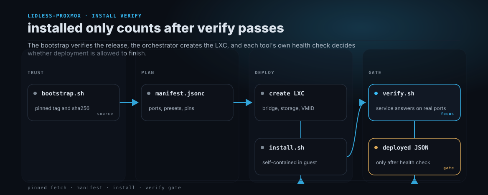

<!-- TODO: banner art pending. Add docs/assets/lidless-proxmox-social-preview.jpg (2048x878, owl watercolor per ILLUSTRATION.md), then restore:
<p align="center"></p>
-->

<h1 align="center">lidless-proxmox</h1>

<p align="center"><strong>Complete, one-command Proxmox LXC installers for the tools I actually run, each gated by a functional check so "installed" always means "works".</strong></p>

<p align="center"><a href="https://lidless.dev">lidless.dev</a> &middot; <a href="docs/adding-a-tool.md">Docs</a> &middot; <a href="#try-it-in-60-seconds">Quickstart</a></p>

<p align="center">


</p>

One helper script per tool. It builds the container, does the first-run config, and refuses to report success until the tool answers on its real ports.

```console
$ bash -c "$(curl -fsSL https://raw.githubusercontent.com/lidless-labs/lidless-proxmox/v0.1.0/bootstrap.sh)" _ adguard
bootstrap: verifying checksum
AdGuardHome_vtest.tar.gz: OK
[adguard] writing /opt/AdGuardHome/AdGuardHome.yaml
[verify] ok: DNS resolves on :53
[verify] ok: web API responds on :80 (HTTP 200)
adguard deployed on LXC 214 (198.51.100.42)
result JSON: /root/lidless-adguard.json  |  secrets: /var/lib/lidless/secrets/adguard-*.txt
```

<p align="center"><em>One paste on a Proxmox host stands up AdGuard Home, admin set, DNS and web live, verified before it says done.</em></p>

## What it does

`lidless-proxmox` installs self-hosted tools into their own Proxmox LXC from a single command run on the host. Each tool ships three files (a resource manifest, an in-container installer, a health check), and a shared orchestrator sizes the container, runs the installer, then runs the health check as the last gate. The point of difference from the big community script library is the finish line: a tool is not "done" when its package installs, it is done when its `verify.sh` proves the real service answers. The installer libraries are pinned and checksum-verified, not curled live off a moving branch.



Generated from [`docs/assets/workflows/install-verify.json`](docs/assets/workflows/install-verify.json) with the [Lidless fleet-kit workflow renderer](https://github.com/lidless-labs/lidless-fleet-kit/tree/main/workflow).

## Install

Nothing to install on the host beyond `curl`. Every tool is one command, run as root on the Proxmox VE host:

```bash
bash -c "$(curl -fsSL https://raw.githubusercontent.com/lidless-labs/lidless-proxmox/v0.1.0/bootstrap.sh)" _ <tool>
```

`bootstrap.sh` is fetched at a pinned tag. It downloads the matching release tarball, verifies its `sha256`, and only then runs the installer from the verified tree. See [docs/pinning.md](docs/pinning.md).

## Try it in 60 seconds

On a Proxmox VE host with a `vmbr0` bridge and `local-lvm` storage:

```bash
bash -c "$(curl -fsSL https://raw.githubusercontent.com/lidless-labs/lidless-proxmox/v0.1.0/bootstrap.sh)" _ adguard
```

It creates an unprivileged LXC, installs AdGuard Home pinned to `v0.107.52`, writes a full config (admin user, DNS on 53, web on 80, Quad9 DoH upstream), starts the service, and verifies DNS resolves and the web API answers before printing the container IP and the path to the generated admin password.

To try it without touching production numbering, use the smoke band (VMID 9000-9099, hostname `ll-smoke-<tool>`):

```bash
LL_SMOKE=1 bash lib/deploy-one.sh adguard   # from a checkout on the host
```

## Tools

| Tool | What it deploys | Ports |
|---|---|---|
| `adguard` | AdGuard Home, fully configured (admin, DNS, web, DoH upstream) | 53, 80 |
| `wazuh` | Wazuh single-node (manager, indexer, dashboard), admin password rotated | 443, 1514, 1515, 55000 |
| `scratch` | Throwaway Debian LXC in the smoke band, for testing and ad-hoc commands | - |

More tools (UniFi, LibreNMS, standalone TheHive / Cortex / MISP) land in later phases. Each is three files: see [docs/adding-a-tool.md](docs/adding-a-tool.md).

`scratch` is host-side (not a curl one-liner). Spin a throwaway container to poke at:

```bash
bash tools/scratch/scratch.sh --label probe --run 'uname -a'   # keeps the CT; reaper GCs later
bash tools/scratch/scratch.sh --reap --run 'apt-get -v'        # destroys it when done
```

`tools/lidless-smoke-reaper.sh` is a cron GC that destroys anything aged in the 9000-9099 smoke band; production VMIDs are never touched.

## Configuration

The orchestrator reads environment variables (all optional):

| Variable | Default | Purpose |
|---|---|---|
| `LL_PRESET` | `standard` | Resource preset from the tool manifest (`minimal`, `standard`, ...) |
| `LL_BRIDGE` | `vmbr0` | Proxmox bridge |
| `LL_STORAGE` | `local-lvm` | rootfs storage pool |
| `LL_SMOKE` | `0` | `1` allocates in the 9000-9099 reaper band, hostname `ll-smoke-<tool>` |
| `LL_FORCE` | `0` | Redeploy even if state says the tool is already deployed |
| `LL_DRY_RUN` | `0` | Plan only, create nothing |

## Why not community-scripts/ProxmoxVE?

That library is broad and useful, and it is where a lot of people start. Two things pushed me to build my own curated set. First, coverage over completeness: with 400-plus volunteer scripts, some install a backend and stop, and there is no functional test in CI to catch it, so a script can be green and still leave you without a working tool. Second, the install path sources its shared functions live from the `main` branch at run time, as root on the hypervisor. `lidless-proxmox` covers only tools I run, holds each to a working-service bar enforced by `verify.sh`, and pins plus checksums everything it executes.

## What lidless-proxmox is not

It is not a catalog trying to cover every app. It is not a configuration manager: it installs and does first-run config, it does not reconcile drift over time. It is not a substitute for [soc-stack](https://github.com/lidless-labs/soc-stack), which stands up the whole SOC as one integrated bundle. This repo is the a-la-carte, one-tool-at-a-time counterpart.

## Docs

- [Adding a tool](docs/adding-a-tool.md) - the three-file contract
- [Pinning and the install trust model](docs/pinning.md)
- [Security model](docs/security-model.md)

## License

MIT. A Lidless Labs project. Home: [lidless.dev](https://lidless.dev). The eye does not close.
